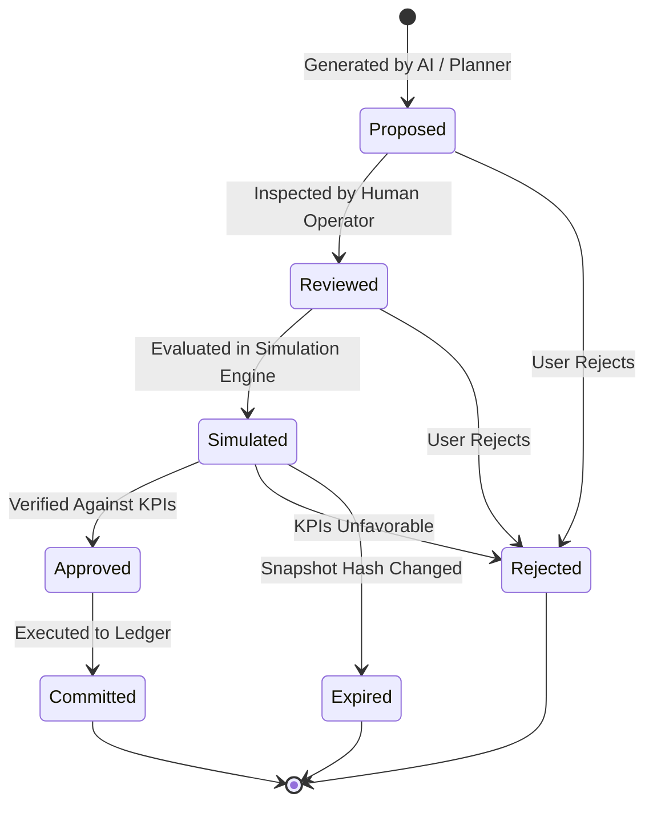

# Fulcrum — Domain Model Specification

## 1. Domain Entities & Value Objects

The Fulcrum domain is designed around DDD aggregates, explicit value objects, and immutable event streams.

```
+---------------------------------------------------------------------------------+
|                                 Warehouse Layout                                |
|  - LayoutVersionId, WorkspaceId, TemplateConfig, PhysicalDimensions, LevelDefs  |
+---------------------------------------------------------------------------------+
                                      |
                                      v
+---------------------------------------------------------------------------------+
|                                     Location                                    |
|  - LocationId, WorkspaceId, LayoutVersionId                                     |
|  - Code: string (e.g. EH14D, H14D, 08-14-B)                                     |
|  - Structured: { side?: string, row: string, column: number, level: string }   |
|  - Coordinates: { x: number, y: number, z: number }                             |
|  - AccessType: 'manual' | 'forklift' | 'any'                                    |
|  - MaxPlatforms: number                                                         |
+---------------------------------------------------------------------------------+
                                      |
                                      v
+---------------------------------------------------------------------------------+
|                                     Platform                                    |
|  - PlatformId, WorkspaceId, LocationId, MaxCapacityUnits                        |
+---------------------------------------------------------------------------------+
                                      |
                                      v
+---------------------------------------------------------------------------------+
|                             Manipulation Unit (MU)                              |
|  - MuId, WorkspaceId, PlatformId | null (if in-transit), Status                 |
+---------------------------------------------------------------------------------+
                                      |
                                      v
+---------------------------------------------------------------------------------+
|                                     Material                                    |
|  - MaterialId, WorkspaceId, MuId, Sku, Quantity, LotNumber, MaterialStatus      |
+---------------------------------------------------------------------------------+
```

---

## 2. Core Aggregates

### 2.1 WarehouseLayout (Aggregate Root)
- **Identity:** `layout_id`, `version: number`, `workspace_id`.
- **State:**
  - `template`: Defines segment presence, padding, characters, and separators.
  - `sides`: Array of side identifiers and descriptive labels.
  - `row_definitions`: Alphabetic or numeric ranges, per-row column counts, and exclusions.
  - `level_definitions`: Ordered list from bottom to top with explicit `access_type` (`manual` | `forklift` | `any`).
  - `physical_dimensions`: `bay_width_meters`, `level_height_meters`, `aisle_width_meters`.
  - `capacity_rules`: Default platforms per location (default 2), default units per platform.
  - `blocked_positions`: Array of structured coordinates representing pillars, mechanical equipment, or aisles.
- **Invariants:**
  - Ambiguous templates (e.g. adjacent variable-width segments without separators) are rejected upon validation.
  - Level ordering must be strictly ascending.
  - Updating a layout requires creating a new incremented version. Existing MUs remain bound to their active version until an explicit remap migration occurs.

### 2.2 Inventory Ledger & Projections
- **Append-Only Ledger (`StockMovement`):**
  - `movement_id: UUID`
  - `workspace_id: string`
  - `idempotency_key: string` (guarantees idempotency)
  - `timestamp: integer` (virtual time in sim, ISO-8601 in production)
  - `movement_type`: `RECEIPT | TRANSFER | PICK | REPLENISHMENT | ADJUSTMENT`
  - `from_location_id?: string`, `to_location_id?: string`
  - `from_mu_id?: string`, `to_mu_id?: string`
  - `sku: string`, `quantity: number`, `lot_number?: string`
  - `operator_id?: string`, `reason?: string`
- **Projection (`CurrentStock`):**
  - Dynamically calculates available stock: `Available = OnHand - Reserved`.
  - Auditable balance verification: every balance can be recomputed by replaying movements from zero.

### 2.3 Reservations
- **Entity (`StockReservation`):**
  - `reservation_id: UUID`
  - `workspace_id: string`
  - `order_id: string`, `line_item_id: string`
  - `sku: string`, `quantity: number`
  - `mu_id: string`, `location_id: string`
  - `status`: `PENDING | COMMITTED | RELEASED | FULFILLED`
  - `expires_at: timestamp`
- **Invariants:**
  - Total active reservations for an SKU across an MU can never exceed the unreserved on-hand balance.

### 2.4 Demand & Tasks
- **Order & LineItem:**
  - `priority`: `CRITICAL | HIGH | STANDARD | LOW`
  - `deadline: integer timestamp`
  - `waiting_tolerance: integer seconds`
  - `fulfillment_status`: `PENDING | ALLOCATED | PICKING | PACKED | DISPATCHED | CANCELLED`
- **FulfillmentTask:**
  - `task_id: UUID`, `task_type`: `PICK | REPLENISH | MOVE`
  - `required_resource`: `MANUAL_PICKER | FORKLIFT_OPERATOR`
  - `target_location_id`: Resolved physical location.
  - `dependency_task_ids`: Array of prerequisites (e.g. replenishment must precede pick).

---

## 3. Plan Lifecycle Aggregate

AI-assisted optimization operates through an auditable plan aggregate:



### Plan Transition Rules:
1. `Proposed`: Contains a list of intended stock movements or task reassignments, tied to an input snapshot SHA-256 hash.
2. `Reviewed`: Operator acknowledges the actions and target locations.
3. `Simulated`: Engine executes the plan against the exact snapshot hash, producing a verifiable simulation run ID and delta metrics.
4. `Approved`: Operator signs off on simulated performance gains.
5. `Committed`: Atomic execution converts proposed actions into immutable `StockMovement` ledger entries.
6. `Expired`: If the operational snapshot hash changes before approval, the plan expires and must be re-simulated.
